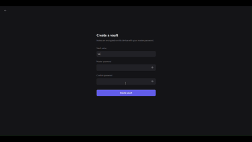
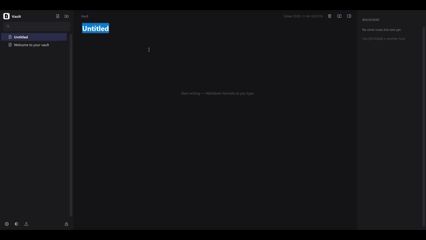

<div align="center">
  

  <h1>Secure Notes</h1>

  <p><strong>Your thoughts. Your machine. Your control.</strong></p>

  <p>An encrypted, local-first Markdown workspace for writing, organizing, and connecting your knowledge.</p>

  <p>
    <a href="https://github.com/niranjan-op/Notes/releases/latest">
      
    </a>
  </p>

  <p>
    <a href="#installation"></a>
    <a href="https://www.python.org/"></a>
    <a href="#security-and-privacy"></a>
    <a href="https://github.com/niranjan-op/Notes/releases"></a>
  </p>

  <p>
    <a href="#core-features">Features</a> &middot;
    <a href="#application-showcase">Showcase</a> &middot;
    <a href="#how-it-works">How It Works</a> &middot;
    <a href="#security-and-privacy">Security</a> &middot;
    <a href="#installation">Installation</a> &middot;
    <a href="#roadmap">Roadmap</a>
  </p>

  <br />

  
</div>

---

## Core Features

<table>
  <tr>
    <td width="33%" valign="top">
      <h3>Privacy by Design</h3>
      <p>Store notes, titles, and folder trees inside password-protected SQLCipher vaults. Maintain multiple isolated vaults and lock your workspace with <code>Ctrl+L</code>.</p>
    </td>
    <td width="33%" valign="top">
      <h3>Effortless Writing</h3>
      <p>Write in hybrid Live Preview where Markdown syntax folds into clean typography off the active line. Edit interactive GFM tables, toggle tasks, or switch to Source and Reading modes.</p>
    </td>
    <td width="33%" valign="top">
      <h3>Connected Knowledge</h3>
      <p>Link ideas inline with <code>[[Wiki Links]]</code> and standard Markdown links. Inspect incoming references in the automatic backlinks panel and organize notes in nested folders.</p>
    </td>
  </tr>
  <tr>
    <td width="33%" valign="top">
      <h3>Local-First Independence</h3>
      <p>Run every workflow offline on your machine across Windows, macOS, and Linux. Secure Notes requires no user account, no cloud service, and no background network connections.</p>
    </td>
    <td width="33%" valign="top">
      <h3>Data Ownership</h3>
      <p>Import individual Markdown files or entire directory trees, merge external vaults read-only, and export any vault or folder to a standard Markdown <code>.zip</code> archive.</p>
    </td>
    <td width="33%" valign="top">
      <h3>Focused Desktop UI</h3>
      <p>Switch between Default (indigo &amp; slate) and Monochrome (pure black &amp; white) palettes with independent Light, Dark, and System modes.</p>
    </td>
  </tr>
</table>

---

## Application Showcase

<div align="center">
  
  <p><em>Hybrid Live-Preview Markdown, interactive GFM tables, connected <code>[[Wiki Links]]</code>, and automatic backlinks.</em></p>
</div>

| View | Highlights |
| :--- | :--- |
| **Main Workspace** | Three-pane desktop layout with collapsible folder tree, distraction-free editor, and automatic backlinks panel. |
| **Live Preview & Tables** | Inline syntax hiding off the cursor line, interactive GFM table grids, clickable task checkboxes, and `[[Wiki Links]]`. |
| **Themes & Typography** | **Default** and **Monochrome** color themes with independent **Light / Dark / System** modes and selectable fonts (`Segoe UI`, `Cascadia Mono`, `Georgia`). |
| **Vault Management** | Dedicated views for creating vaults, unlocking with clipboard-protected password fields, and confirming vault deletion. |

---

## How It Works

<table>
  <tr>
    <td width="33%" valign="top">
      <strong>01. Create a vault</strong>
      <p>Choose a vault name and master password. Secure Notes initializes an encrypted SQLCipher database in your local application data directory.</p>
    </td>
    <td width="33%" valign="top">
      <strong>02. Write and connect ideas</strong>
      <p>Draft notes in Markdown, organize them into nested folders, and link related concepts with <code>[[Wiki Links]]</code> and backlinks.</p>
    </td>
    <td width="33%" valign="top">
      <strong>03. Lock your vault</strong>
      <p>Press <code>Ctrl+L</code> when finished. Pending edits are saved, the database connection closes, and decrypted UI buffers are cleared.</p>
    </td>
  </tr>
</table>

---

## Security and Privacy

Secure Notes protects data at rest using a compiled C++ storage extension (`secure_storage`) built with `pybind11`, **SQLCipher**, and **OpenSSL 3**:

- **SQLCipher Encrypted Storage**: Note titles, note bodies, and folder hierarchies are stored inside an encrypted SQLite database (`<vault>.db`) rather than plaintext files on disk.
- **OpenSSL Password-Derived Keys**: Database keys are derived from your master password through SQLCipher's OpenSSL-backed PBKDF2 key derivation when unlocking a vault.
- **Per-Vault Cryptographic Salts**: Each vault database uses its own random cryptographic salt generated by SQLCipher. Master passwords and derived keys are never written to disk.
- **At-Rest vs. In-Memory Boundary**: Vault data is encrypted on disk while locked. While a vault is unlocked, active note content resides in process memory for editing and rendering.

<details>
<summary><strong>Cryptographic implementation and security boundaries</strong></summary>
<br />

- **Native Extension (`extensions/secure_storage.cpp`)**: All database reads and writes pass through `DbOperations`, which opens the vault file with `sqlite3_open` (or `sqlite3_open_v2` in read-only mode during vault merges) and applies the master password via `sqlite3_key`.
- **Vault Isolation & Path Safety**: Vaults are stored in your platform's user data directory:
  - **Windows**: `%LOCALAPPDATA%\Secure Notes\<vault>`
  - **macOS**: `~/Library/Application Support/Secure Notes/<vault>`
  - **Linux**: `${XDG_DATA_HOME:-~/.local/share}/Secure Notes/<vault>`
  Vault names are validated against path-traversal sequences and reserved filenames.
- **Locking Behavior (`Ctrl+L`)**: Locking flushes unsaved changes, cancels pending UI timers, closes the SQLCipher handle, resets editor and undo buffers, runs Python garbage collection, and requests OS working-set trimming on Windows.
- **Operating System Scope**: Process memory while unlocked, OS pagefiles/swap, and crash dumps remain subject to operating-system memory management. Full-disk encryption (BitLocker, FileVault, or LUKS) is recommended for system-level protection.
- **Unencrypted Exports**: Exporting a vault or folder to a `.zip` archive produces standard, unencrypted `.md` files after an explicit confirmation prompt.
- **Network Scope**: The application makes zero network requests during normal use. Network connections occur only when you click **Check for updates** in Settings, which queries `api.github.com` over HTTPS with strict host validation.

</details>

---

## Installation

Download the latest release for your operating system from [**GitHub Releases**](https://github.com/niranjan-op/Notes/releases/latest):

| Platform | Package | Instructions |
| :--- | :--- | :--- |
| **Windows 10 / 11 (x64)** | `SecureNotes-Setup-1.4.0-x64.exe` <br /> `NotesApp-windows-x64.zip` | Run the setup installer, or extract the portable `.zip` and launch `NotesApp.exe`. |
| **macOS (Apple Silicon / arm64)** | `SecureNotes-1.4.0-macos-arm64.dmg` | Open the `.dmg` disk image and drag **Secure Notes.app** to **Applications**. |
| **Linux (x86_64 / amd64)** | `SecureNotes-1.4.0-linux-x86_64.AppImage` <br /> `SecureNotes-1.4.0-linux-amd64.deb` | Make the AppImage executable (`chmod +x SecureNotes-*.AppImage`) and run it, or install the `.deb` package with `sudo apt install ./SecureNotes-*-linux-amd64.deb`. |

<details>
<summary><strong>Run from source (Windows, macOS &amp; Linux)</strong></summary>
<br />

**1. Clone the repository and create a Python 3.13 virtual environment:**

```bash
git clone https://github.com/niranjan-op/Notes.git
cd Notes
python -m venv .venv
```

**2. Install dependencies and build/install the native storage extension:**

- **Windows (PowerShell):**
  ```powershell
  .\.venv\Scripts\Activate.ps1
  pip install -r requirements.txt
  pip install wheelhouse\secure_storage-0.1-cp313-cp313-win_amd64.whl
  ```

- **macOS:**
  ```bash
  source .venv/bin/activate
  brew install sqlcipher openssl@3
  pip install -r requirements.txt
  python setup.py build_ext --inplace
  ```

- **Linux (Ubuntu / Debian):**
  ```bash
  source .venv/bin/activate
  sudo apt-get update && sudo apt-get install -y libsqlcipher-dev libssl-dev
  pip install -r requirements.txt
  python setup.py build_ext --inplace
  ```

**3. Launch Secure Notes:**

```bash
python main.py
```

</details>

---

## Roadmap

The following capabilities are **planned** for future releases and are not part of the current build:

- [ ] **Encrypted Backups & Recovery** — Automated encrypted vault snapshots, integrity checks, and one-click restore workflows.
- [ ] **Search & Navigation** — In-document find and replace, heading outline panel, and keyboard command palette.
- [ ] **Knowledge Graph Visualization** — Interactive graph view for exploring note links and clusters.
- [ ] **Templates & Daily Notes** — Reusable note templates, frontmatter properties, and daily journaling shortcuts.
- [ ] **Optional User-Controlled Sync** — Encrypted snapshot synchronization across devices without mandatory cloud accounts.

---

## Technical Reference

<details>
<summary><strong>Keyboard shortcuts</strong></summary>
<br />

| Shortcut | Action |
| :--- | :--- |
| `Ctrl+N` | Create a new note in the current folder |
| `Ctrl+Shift+N` | Create a new folder |
| `Ctrl+F` | Focus sidebar search |
| `Ctrl+S` | Save current note immediately (autosaves after 650 ms) |
| `Ctrl+E` | Toggle between **Live Preview** and **Source** mode |
| `Ctrl+R` | Toggle **Reading** and **Editing** mode |
| `Ctrl+,` | Open **Settings** |
| `Ctrl+L` | Save and **Lock** the active vault |
| `Escape` | Clear search filter or close the active dialog |

</details>

<details>
<summary><strong>Architecture overview</strong></summary>
<br />

```text
Notes/
├── main.py                      # Application entry point & window lifecycle
├── app/
│   ├── core/
│   │   ├── config.py            # Vault paths, config.ini & user preferences
│   │   ├── vault.py             # Encrypted Vault adapter, links, merge & .zip export
│   │   ├── markdown.py          # Block & inline Markdown parser / tokenizer
│   │   └── updater.py           # GitHub Releases update checker & installer runner
│   └── UI/
│       ├── styles.py            # Design tokens & Default / Monochrome palettes
│       ├── brand.py             # Vector line-icon renderer & adaptive brand marks
│       ├── components.py        # Dialogs, buttons, tooltips & PasswordField
│       ├── welcome_view.py      # Vault picker & deletion confirmation
│       ├── setup_view.py        # New vault creation view
│       ├── login_view.py        # Master password unlock view
│       ├── main_view.py         # Three-pane workspace (tree, editor, backlinks)
│       └── markdown_editor.py   # Live-preview controller & interactive GFM tables
├── extensions/
│   └── secure_storage.cpp       # C++ pybind11 + SQLCipher + OpenSSL storage extension
├── packaging/                   # Inno Setup script & installer build pipeline
└── tests/                       # Unit & encrypted storage integration test suite
```

</details>

<details>
<summary><strong>Running tests and building installers</strong></summary>
<br />

**Run the test suite:**

```bash
python -m unittest discover -s tests -v
```

**Package desktop builds with PyInstaller:**

```bash
python -m PyInstaller --noconfirm --clean NotesApp.spec
```

- **Windows installer** (requires [Inno Setup 6](https://jrsoftware.org/isinfo.php)):
  ```powershell
  powershell -ExecutionPolicy Bypass -File packaging\build_installer.ps1
  ```
- **macOS `.dmg` and Linux `.AppImage` / `.deb`**: Automated via [`.github/workflows/release.yml`](.github/workflows/release.yml) on `v*` tags.

</details>
